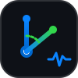
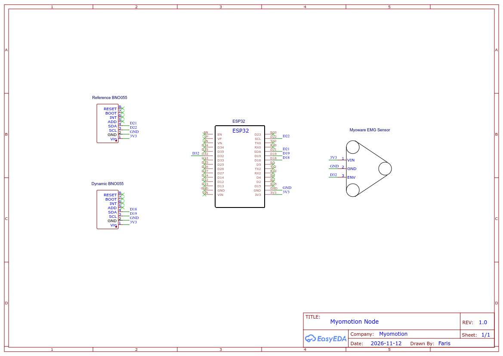

<p align="center">
  
</p>

<h1 align="center">MyoMotion</h1>

<p align="center">
  <b>Dual-Joint Upper-Limb Kinematics &amp; MyoWare 2.0 sEMG Rehabilitation Biofeedback Platform</b>
</p>

<p align="center">
  
  
  
  
  
  
</p>

> **MyoMotion** is an end-to-end neuromuscular rehabilitation and clinical biomechanics platform that monitors **Elbow Curl (Biceps)** and **Wrist Curl (Forearm)** range of motion via dual magnetic-decoupled 6-DoF IMUs alongside real-time **MyoWare 2.0** surface electromyography (%MVC) biofeedback.

---

## 📑 Language Options / Pilihan Bahasa
* 🇬🇧 **[English Documentation (Current)](README.md)**
* 🇲🇾 **[Dokumentasi Bahasa Melayu](README_MY.md)**

---

## 🏗️ High-Level System Architecture

```text
+----------------------------------+         MQTT (20 Hz JSON + LWT)         +---------------------------+
|      ESP32 Wearable Node         | ========================================> |  Eclipse Mosquitto Broker |
|  - BNO055 #1 (I2C Bus 0: 21/22)  |                                           |  TCP: 1883 / WS: 9001     |
|  - BNO055 #2 (I2C Bus 1: 18/19)  | <======================================== |  LWT: myomotion/status/+  |
|  - MyoWare 2.0 ENV (GPIO 32 ADC) |         Commands (mode/tare/cal)          +-------------+-------------+
+----------------------------------+                                                         |
                                                                               Paho-MQTT     |
                                                                               Client        v
+----------------------------------+       WebSocket (/ws/telemetry)           +---------------------------+
|     Clinician Web Dashboard      | <======================================== |  FastAPI Backend Engine   |
|  - 60 FPS Canvas Arm Simulation  |                                           |  - JWT HttpOnly + Lockout |
|  - ROM Calibration & Rep Counter | <---------------------------------------> |  - SlowAPI + CSRF Guard   |
|  - Live %MVC EMG Oscilloscope    |          REST API (/api/*)                |  - PostgreSQL + Alembic   |
+----------------------------------+                                           +-------------+-------------+
                                                                                             |
                                                                               Resend API    v
                                                                               +---------------------------+
                                                                               |   Email OTP (10-Min TTL)  |
                                                                               +---------------------------+
```

---

## 🔌 Hardware Circuit & Wiring Schematic

<p align="center">
  
</p>

* 📄 **Download Printable Schematic PDF:** [`Schematic_myomotion_2026-11-12.pdf`](Schematic_myomotion_2026-11-12.pdf)
* 📄 **Detailed Wiring & Pinout Guide:** [`esp32/PINOUT_AND_WIRING.md`](esp32/PINOUT_AND_WIRING.md)

---

## 📌 Hardware Pinout Table

| ESP32 Pin | Connected Component | Signal / Bus | Technical Specifications |
| :--- | :--- | :--- | :--- |
| **GPIO 21** | Reference BNO055 (#1) `SDA` | I2C Bus 0 (`Wire`) | 3.3V logic, I2C Addr `0x29` (Proximal segment) |
| **GPIO 22** | Reference BNO055 (#1) `SCL` | I2C Bus 0 (`Wire`) | 3.3V logic, `OPERATION_MODE_IMUPLUS` (6-DoF) |
| **GPIO 18** | Dynamic BNO055 (#2) `SDA` | I2C Bus 1 (`TwoWire(1)`) | 3.3V logic, I2C Addr `0x29` (Distal segment) |
| **GPIO 19** | Dynamic BNO055 (#2) `SCL` | I2C Bus 1 (`TwoWire(1)`) | 3.3V logic, `OPERATION_MODE_IMUPLUS` (6-DoF) |
| **GPIO 32** | MyoWare 2.0 `ENV` | Analog Input (`ADC1_CH4`) | 12-bit resolution (`0–4095`), `ADC_11db` attenuation |
| **3V3** | BNO055 #1, #2 &amp; MyoWare `VIN` | Power Rail | Regulated 3.3V DC (isolated via ADuM USB isolator) |
| **GND** | BNO055 #1, #2 &amp; MyoWare `GND` | Reference Ground | Common isolated ground plane |

---

## ✨ Key Features & Algorithmic Highlights

* **Magnetometer-Free 6-DoF Kinematics (`IMUPLUS`):** Locks both Bosch BNO055 sensors into Gyro + Accelerometer fusion to eliminate sudden heading jumps caused by moving power cables or indoor electromagnetic noise.
* **Dual-Exercise Sagittal Pipeline:**
  * **Elbow Curl (Biceps):** Relative quaternion displacement $\theta = 2 \arccos(|w|)$ with configurable Straight (`Min`) and Max Flexion (`Max`) ROM targets.
  * **Wrist Curl (Forearm):** Singularity-free sagittal pitch projection $\text{atan2}(-v_z, v_x)$ with configurable Bottom (`Lowest`) and Top (`Highest`) ROM boundaries.
* **MyoWare 2.0 12-Bit Biofeedback:** 8-sample oversampling filter with two-point **Relax Baseline (0%)** and **3-Second Max Grip Peak (100%)** normalization.
* **Hybrid EMG-Verified Repetition State Machine:** Counts valid repetitions only when the joint travels across calibrated ROM zones (`<=25%` to `>=75%`) *and* muscle activation exceeds `>= 20% MVC`, preventing passive arm swings from registering as reps.
* **60 FPS Articulated Arm Canvas:** Real-time browser animation with dynamic muscle activation heatmap (Blue $\rightarrow$ Green $\rightarrow$ Red) and vertical ROM progress bar.
* **Enterprise-Grade Security:** JWT stored strictly in `HttpOnly`, `Secure`, `SameSite=Lax` cookies, CSRF origin validation, 15-minute lockout after 5 failed logins, 10-minute single-use Resend OTPs, `SlowAPI` rate limiting, and non-root Docker execution.

---

## 📁 Repository Structure

```text
.
├── .gitignore
├── README.md
├── README_MY.md
├── logo.svg
├── favicon.svg
├── favicon.ico
├── Schematic_myomotion_2026-11-12.png
├── Schematic_myomotion_2026-11-12.pdf
├── esp32/
│   ├── README.md
│   ├── README_MY.md
│   ├── PINOUT_AND_WIRING.md
│   ├── PINOUT_AND_WIRING_MY.md
│   ├── MQTT_SPECIFICATION.md
│   ├── MQTT_SPECIFICATION_MY.md
│   ├── FLASHING_AND_SETUP.md
│   ├── FLASHING_AND_SETUP_MY.md
│   └── MyoMotion_ESP32_Firmware/
│       └── MyoMotion_ESP32_Firmware.ino
└── MyoMotion/
    ├── .env.example
    ├── docker-compose.yml
    ├── simulate_node.py
    ├── run_simulation.sh
    ├── README.md
    ├── README_MY.md
    ├── API_DOCUMENTATION.md
    ├── API_DOCUMENTATION_MY.md
    ├── DOCKER_AND_SERVICES.md
    ├── DOCKER_AND_SERVICES_MY.md
    ├── SECURITY_AND_ARCHITECTURE.md
    ├── SECURITY_AND_ARCHITECTURE_MY.md
    ├── mosquitto/
    │   └── config/
    │       └── mosquitto.conf
    ├── backend/
    │   ├── Dockerfile
    │   ├── requirements.txt
    │   ├── alembic.ini
    │   ├── alembic/
    │   ├── main.py
    │   ├── database.py
    │   ├── schemas.py
    │   ├── auth.py
    │   ├── middleware.py
    │   ├── email_service.py
    │   ├── mqtt_manager.py
    │   ├── websocket_manager.py
    │   └── routers/
    │       ├── auth_routes.py
    │       ├── device_routes.py
    │       ├── rehab_routes.py
    │       └── telemetry_routes.py
    └── frontend/
        ├── Dockerfile
        ├── nginx.conf
        ├── index.html
        ├── rehab.html
        ├── history.html
        ├── settings.html
        ├── login.html
        ├── privacy.html
        ├── 404.html
        ├── style.css
        ├── app.js
        ├── auth.js
        ├── arm-animation.js
        ├── favicon.ico
        ├── favicon.svg
        ├── logo.svg
        ├── og-preview.png
        ├── robots.txt
        ├── sitemap.xml
        └── llms.txt
```

---

## 🚀 Quick Start Guide

### 1. Deploy the Docker Stack
```bash
# Ensure shared Docker network exists
docker network inspect pwn20wnd-network >/dev/null 2>&1 || docker network create pwn20wnd-network

# Configure environment variables
cd MyoMotion
cp .env.example .env
# Edit .env with your PostgreSQL password, JWT secret, and Resend API key

# Build and start all services
docker compose up -d --build
```

### 2. Flash ESP32 Firmware or Run Hardware Simulator
* **Physical ESP32:** Open `esp32/MyoMotion_ESP32_Firmware/MyoMotion_ESP32_Firmware.ino` in Arduino IDE, flash to ESP32, connect to the `MyoMotionAP` WiFi portal (20-second captive portal window), and enter your WiFi & MQTT broker host/port. Full guide: [`esp32/FLASHING_AND_SETUP.md`](esp32/FLASHING_AND_SETUP.md).
* **Hardware Simulator (No ESP32 Required):**
  ```bash
  cd MyoMotion
  ./run_simulation.sh
  ```

### 3. Access the Dashboard
1. Navigate to `http://localhost:8841/login` and register your account via Email OTP.
2. Open **Device Settings** (`/settings`) and link your ESP32 MAC address (e.g., `CC7B5C284994`).
3. Launch **Active Rehab** (`/rehab`), choose **Elbow Curl** or **Wrist Curl**, calibrate Relax/MVC and ROM limits, and start recording.

---

## 📜 License
* Developed for **Educational Purposes Only**.
