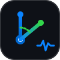
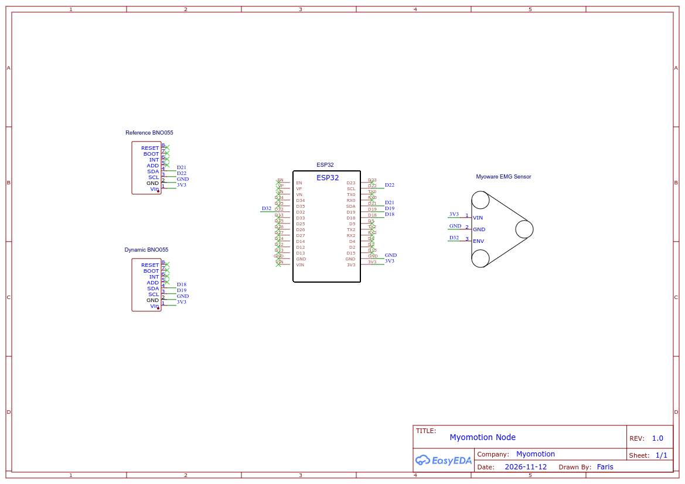

<p align="center">
  
</p>

<h1 align="center">MyoMotion</h1>

<p align="center">
  <b>Platform Rehabilitasi Kinematik Anggota Atas &amp; Bioumpan Balik sEMG MyoWare 2.0</b>
</p>

<p align="center">
  
  
  
  
  
  
</p>

> **MyoMotion** ialah platform rehabilitasi neuromuskular dan biomekanik klinikal hujung-ke-hujung yang memantau julat pergerakan (*Range of Motion*) **Elbow Curl (Biceps)** dan **Wrist Curl (Forearm)** menggunakan dwi-sensor IMU 6-DoF bebas gangguan magnet bersama bioumpan balik elektromiografi permukaan (**MyoWare 2.0 %MVC**) secara masa nyata.

---

## 📑 Language Options / Pilihan Bahasa
* 🇬🇧 **[English Documentation](README.md)**
* 🇲🇾 **[Dokumentasi Bahasa Melayu (Semasa)](README_MY.md)**

---

## 🏗️ Seni Bina Sistem Aras Tinggi

```text
+----------------------------------+         MQTT (20 Hz JSON + LWT)         +---------------------------+
|      Nod Boleh Pakai ESP32       | ========================================> |  Broker Eclipse Mosquitto |
|  - BNO055 #1 (I2C Bus 0: 21/22)  |                                           |  TCP: 1883 / WS: 9001     |
|  - BNO055 #2 (I2C Bus 1: 18/19)  | <======================================== |  LWT: myomotion/status/+  |
|  - MyoWare 2.0 ENV (GPIO 32 ADC) |        Arahan (mode/tare/cal)             +-------------+-------------+
+----------------------------------+                                                         |
                                                                               Klien         |
                                                                               Paho-MQTT     v
+----------------------------------+       WebSocket (/ws/telemetry)           +---------------------------+
|     Papan Pemuka Klinikal Web    | <======================================== |  Enjin Backend FastAPI    |
|  - Animasi Lengan Kanvas 60 FPS  |                                           |  - JWT HttpOnly + Lockout |
|  - Kalibrasi ROM & Kiraan Rep    | <---------------------------------------> |  - SlowAPI + Guard CSRF   |
|  - Osiloskop %MVC EMG Langsung   |          REST API (/api/*)                |  - PostgreSQL + Alembic   |
+----------------------------------+                                           +-------------+-------------+
                                                                                             |
                                                                               API Resend    v
                                                                               +---------------------------+
                                                                               |   OTP E-mel (Tamat 10m)   |
                                                                               +---------------------------+
```

---

## 🔌 Skematik Litar & Pendawaian Perkakasan

<p align="center">
  
</p>

* 📄 **Muat Turun PDF Skematik Boleh Cetak:** [`Schematic_myomotion_2026-11-12.pdf`](Schematic_myomotion_2026-11-12.pdf)
* 📄 **Panduan Terperinci Pinout & Pendawaian:** [`esp32/PINOUT_AND_WIRING_MY.md`](esp32/PINOUT_AND_WIRING_MY.md)

---

## 📌 Jadual Pinout Perkakasan

| Pin ESP32 | Komponen Disambung | Isyarat / Bas | Spesifikasi Teknikal |
| :--- | :--- | :--- | :--- |
| **GPIO 21** | BNO055 Rujukan (#1) `SDA` | I2C Bus 0 (`Wire`) | Logik 3.3V, Alamat I2C `0x29` (Segmen Proksimal) |
| **GPIO 22** | BNO055 Rujukan (#1) `SCL` | I2C Bus 0 (`Wire`) | Logik 3.3V, `OPERATION_MODE_IMUPLUS` (6-DoF) |
| **GPIO 18** | BNO055 Dinamik (#2) `SDA` | I2C Bus 1 (`TwoWire(1)`) | Logik 3.3V, Alamat I2C `0x29` (Segmen Distal) |
| **GPIO 19** | BNO055 Dinamik (#2) `SCL` | I2C Bus 1 (`TwoWire(1)`) | Logik 3.3V, `OPERATION_MODE_IMUPLUS` (6-DoF) |
| **GPIO 32** | MyoWare 2.0 `ENV` | Input Analog (`ADC1_CH4`) | Resolusi 12-bit (`0–4095`), atenuasi `ADC_11db` |
| **3V3** | BNO055 #1, #2 &amp; MyoWare `VIN` | Rel Kuasa | 3.3V DC teratur (diasingkan melalui pengasing USB ADuM) |
| **GND** | BNO055 #1, #2 &amp; MyoWare `GND` | Bumi Sepunya | Satah bumi terasing sepunya |

---

## ✨ Ciri Utama &amp; Inovasi Algoritma

* **Kinematik 6-DoF Bebas Magnetometer (`IMUPLUS`):** Mengunci kedua-dua sensor Bosch BNO055 kepada gabungan Giroskop + Akselerometer bagi mengelakkan lonjakan sudut secara tiba-tiba akibat gangguan wayar atau medan magnet dalaman.
* **Saluran Dwi-Senaman Sagital:**
  * **Elbow Curl (Biceps):** Sesaran kuaternion relatif $\theta = 2 \arccos(|w|)$ dengan sasaran ROM Lurus (`Min`) dan Fleksi Maksimum (`Max`) boleh kalibrasi.
  * **Wrist Curl (Forearm):** Unjuran vektor pic sagital bebas singulariti $\text{atan2}(-v_z, v_x)$ dengan had ROM Bawah (`Bottom`) dan Atas (`Top`) boleh kalibrasi.
* **Bioumpan Balik MyoWare 2.0 12-Bit:** Penapis purata 8-sampel dengan penormalan dua titik **Relax Baseline (0%)** dan **Max Grip Peak 3-Saat (100%)**.
* **Mesin Keadaan Ulangan Hibrid (Disahkan EMG):** Mengira ulangan sah hanya apabila sendi merentasi julat ROM terkalibrasi (`<=25%` ke `>=75%`) *serta* pengaktifan otot melebihi `>= 20% MVC`, mengelakkan ayunan tangan pasif daripada dikira sebagai ulangan.
* **Kanvas Lengan Berartikulasi 60 FPS:** Animasi pelayar masa nyata dengan peta haba pengaktifan otot dinamik (Biru $\rightarrow$ Hijau $\rightarrow$ Merah) serta bar kemajuan ROM menegak.
* **Keselamatan Bertaraf Perusahaan:** JWT disimpan secara eksklusif dalam kuki `HttpOnly`, `Secure`, `SameSite=Lax`, pengesahan asal CSRF, penguncian akaun 15 minit selepas 5 cubaan log masuk gagal, OTP Resend 10 minit sekali guna, pengehadan kadar `SlowAPI`, serta kontena Docker bukan-root.

---

## 📁 Struktur Repositori

```text
.
├── .gitignore
├── README.md
├── README_MY.md
├── logo.svg
├── favicon.svg
├── favicon.ico
├── Schematic_myomotion_2026-11-12.png
├── Schematic_myomotion_2026-11-12.pdf
├── esp32/
│   ├── README.md
│   ├── README_MY.md
│   ├── PINOUT_AND_WIRING.md
│   ├── PINOUT_AND_WIRING_MY.md
│   ├── MQTT_SPECIFICATION.md
│   ├── MQTT_SPECIFICATION_MY.md
│   ├── FLASHING_AND_SETUP.md
│   ├── FLASHING_AND_SETUP_MY.md
│   └── MyoMotion_ESP32_Firmware/
│       └── MyoMotion_ESP32_Firmware.ino
└── MyoMotion/
    ├── .env.example
    ├── docker-compose.yml
    ├── simulate_node.py
    ├── run_simulation.sh
    ├── README.md
    ├── README_MY.md
    ├── API_DOCUMENTATION.md
    ├── API_DOCUMENTATION_MY.md
    ├── DOCKER_AND_SERVICES.md
    ├── DOCKER_AND_SERVICES_MY.md
    ├── SECURITY_AND_ARCHITECTURE.md
    ├── SECURITY_AND_ARCHITECTURE_MY.md
    ├── mosquitto/
    │   └── config/
    │       └── mosquitto.conf
    ├── backend/
    │   ├── Dockerfile
    │   ├── requirements.txt
    │   ├── alembic.ini
    │   ├── alembic/
    │   ├── main.py
    │   ├── database.py
    │   ├── schemas.py
    │   ├── auth.py
    │   ├── middleware.py
    │   ├── email_service.py
    │   ├── mqtt_manager.py
    │   ├── websocket_manager.py
    │   └── routers/
    │       ├── auth_routes.py
    │       ├── device_routes.py
    │       ├── rehab_routes.py
    │       └── telemetry_routes.py
    └── frontend/
        ├── Dockerfile
        ├── nginx.conf
        ├── index.html
        ├── rehab.html
        ├── history.html
        ├── settings.html
        ├── login.html
        ├── privacy.html
        ├── 404.html
        ├── style.css
        ├── app.js
        ├── auth.js
        ├── arm-animation.js
        ├── favicon.ico
        ├── favicon.svg
        ├── logo.svg
        ├── og-preview.png
        ├── robots.txt
        ├── sitemap.xml
        └── llms.txt
```

---

## 🚀 Panduan Mula Pantas

### 1. Lancarkan Susunan Docker
```bash
# Pastikan rangkaian Docker sepunya wujud
docker network inspect pwn20wnd-network >/dev/null 2>&1 || docker network create pwn20wnd-network

# Tetapkan pemboleh ubah persekitaran
cd MyoMotion
cp .env.example .env
# Kemas kini .env dengan kata laluan PostgreSQL, kunci rahsia JWT dan kunci API Resend anda

# Bina dan jalankan semua perkhidmatan
docker compose up -d --build
```

### 2. Muat Naik Perisian Tegar ESP32 atau Jalankan Simulator Perkakasan
* **ESP32 Fizikal:** Buka `esp32/MyoMotion_ESP32_Firmware/MyoMotion_ESP32_Firmware.ino` dalam Arduino IDE, muat naik ke ESP32, sambung ke WiFi `MyoMotionAP` (portal tawan 20 saat), dan masukkan SSID WiFi serta hos/port broker MQTT anda. Panduan penuh: [`esp32/FLASHING_AND_SETUP_MY.md`](esp32/FLASHING_AND_SETUP_MY.md).
* **Simulator Perkakasan (Tanpa ESP32):**
  ```bash
  cd MyoMotion
  ./run_simulation.sh
  ```

### 3. Akses Papan Pemuka
1. Layari `http://localhost:8841/login` dan daftar akaun anda menggunakan OTP e-mel.
2. Buka **Device Settings** (`/settings`) dan daftarkan alamat MAC ESP32 anda (cth: `CC7B5C284994`).
3. Buka **Active Rehab** (`/rehab`), pilih **Elbow Curl** atau **Wrist Curl**, kalibrasi Relax/MVC serta had ROM, dan mulakan sesi rakaman.

---

## 📜 Lesen
* Dibangunkan untuk **Tujuan Pendidikan Sahaja**.
