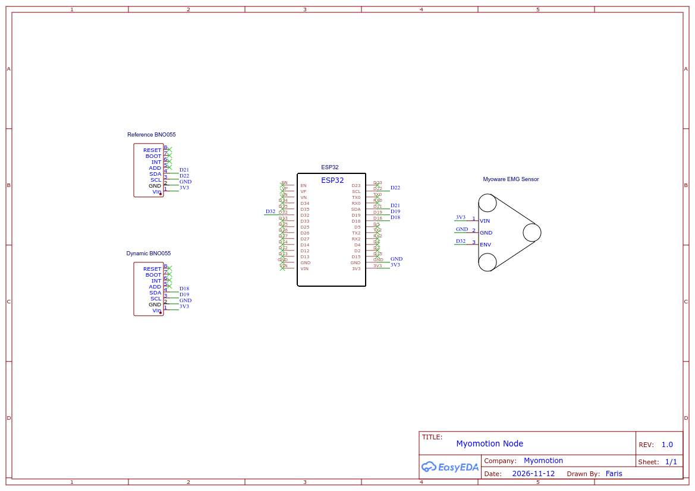

# Hardware Pinout & Wiring Guide

> Complete pin mapping, dual-I2C bus layout, and biomedical electrical safety practices for the MyoMotion ESP32 sensor node.

## 📑 Language Options / Pilihan Bahasa
* 🇬🇧 **[English (Current)](PINOUT_AND_WIRING.md)**
* 🇲🇾 **[Bahasa Melayu](PINOUT_AND_WIRING_MY.md)**

---

## 🔌 Circuit Schematic

  

* 📄 **Printable Vector Schematic:** [`Schematic_myomotion_2026-11-12.pdf`](../Schematic_myomotion_2026-11-12.pdf)

---

## 📌 Complete Pinout Table

### 1. Reference BNO055 (#1 — Proximal Segment, I2C Bus 0 / `Wire`)
*Placement: Upper arm (Biceps) for Elbow Curl mode, or Forearm for Wrist Curl mode.*

| BNO055 Pin | ESP32 Pin | Notes |
| :--- | :--- | :--- |
| `VIN` | `3V3` | Regulated 3.3V power |
| `GND` | `GND` | Common isolated ground |
| `SDA` | `GPIO 21` | `I2C_SDA_PIN_1` |
| `SCL` | `GPIO 22` | `I2C_SCL_PIN_1` |
| `ADD` / `ADR` | `3V3` | Forces I2C address to `0x29` |

### 2. Dynamic BNO055 (#2 — Distal Segment, I2C Bus 1 / `TwoWire(1)`)
*Placement: Forearm for Elbow Curl mode, or Hand Dorsum for Wrist Curl mode.*

| BNO055 Pin | ESP32 Pin | Notes |
| :--- | :--- | :--- |
| `VIN` | `3V3` | Regulated 3.3V power |
| `GND` | `GND` | Common isolated ground |
| `SDA` | `GPIO 18` | `I2C_SDA_PIN_2` |
| `SCL` | `GPIO 19` | `I2C_SCL_PIN_2` |
| `ADD` / `ADR` | `3V3` | Forces I2C address to `0x29` |

### 3. MyoWare 2.0 Muscle Sensor (sEMG)
*Placement: Biceps Brachii belly (Elbow Curl) or Forearm Flexors (Wrist Curl).*

| MyoWare 2.0 Pin | ESP32 Pin | Notes |
| :--- | :--- | :--- |
| `VIN` (`+`) | `3V3` | **Strictly 3.3V** (ESP32 ADC max input is 3.3V) |
| `GND` (`-`) | `GND` | Common isolated ground |
| `ENV` | `GPIO 32` | `ADC1_CH4` (ADC1 remains fully functional while WiFi is active) |

---

## 🛡️ Electrical & Biomedical Safety Guidelines

1. **Galvanic USB Isolation (Mandatory):** Always power and connect the ESP32 through an **ADuM-based USB Isolator** when electrodes are attached to human skin. This breaks mains-earth ground loops, prevents leakage current hazards, and eliminates 50/60 Hz mains hum on the EMG waveform.
2. **ADC1 vs ADC2 on ESP32:** `GPIO 32` belongs to `ADC1`. Never move the MyoWare signal pin to `ADC2` pins (`GPIO 0, 2, 4, 12–15, 25–27`), as ESP32 hardware disables `ADC2` while WiFi is active.
3. **Independent Physical I2C Buses:** Separating both BNO055 sensors onto `Wire` (`21/22`) and `TwoWire(1)` (`18/19`) prevents bus capacitance buildup over long arm cables and allows identical `0x29` addressing without collision.
4. **3.3V Logic Compliance:** Never supply 5V directly to the MyoWare `VIN` pin when feeding `ENV` into an ESP32 GPIO, as output swings above 3.3V can damage the ADC input stage.
