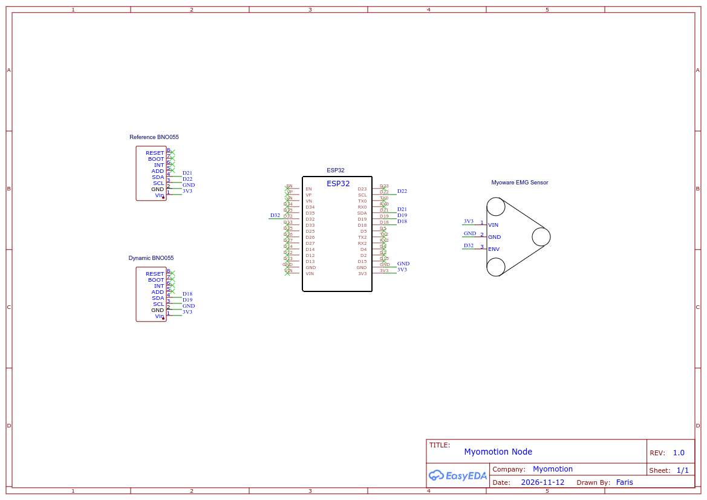

# Panduan Pinout &amp; Pendawaian Perkakasan

> Pemetaan pin lengkap, susun atur dwi-bas I2C, dan amalan keselamatan elektrik bioperubatan untuk nod sensor ESP32 MyoMotion.

## 📑 Language Options / Pilihan Bahasa
* 🇬🇧 **[English](PINOUT_AND_WIRING.md)**
* 🇲🇾 **[Bahasa Melayu (Semasa)](PINOUT_AND_WIRING_MY.md)**

---

## 🔌 Skematik Litar

  

* 📄 **Skematik Vektor Boleh Cetak:** [`Schematic_myomotion_2026-11-12.pdf`](../Schematic_myomotion_2026-11-12.pdf)

---

## 📌 Jadual Pinout Lengkap

### 1. BNO055 Rujukan (#1 — Segmen Proksimal, I2C Bus 0 / `Wire`)
*Peletakan: Lengan atas (Biceps) untuk mod Elbow Curl, atau Lengan bawah (Forearm) untuk mod Wrist Curl.*

| Pin BNO055 | Pin ESP32 | Nota |
| :--- | :--- | :--- |
| `VIN` | `3V3` | Kuasa 3.3V teratur |
| `GND` | `GND` | Bumi terasing sepunya |
| `SDA` | `GPIO 21` | `I2C_SDA_PIN_1` |
| `SCL` | `GPIO 22` | `I2C_SCL_PIN_1` |
| `ADD` / `ADR` | `3V3` | Menetapkan alamat I2C kepada `0x29` |

### 2. BNO055 Dinamik (#2 — Segmen Distal, I2C Bus 1 / `TwoWire(1)`)
*Peletakan: Lengan bawah (Forearm) untuk mod Elbow Curl, atau Belakang tapak tangan untuk mod Wrist Curl.*

| Pin BNO055 | Pin ESP32 | Nota |
| :--- | :--- | :--- |
| `VIN` | `3V3` | Kuasa 3.3V teratur |
| `GND` | `GND` | Bumi terasing sepunya |
| `SDA` | `GPIO 18` | `I2C_SDA_PIN_2` |
| `SCL` | `GPIO 19` | `I2C_SCL_PIN_2` |
| `ADD` / `ADR` | `3V3` | Menetapkan alamat I2C kepada `0x29` |

### 3. Sensor Otot MyoWare 2.0 (sEMG)
*Peletakan: Otot Biceps Brachii (Elbow Curl) atau Otot Fleksor Forearm (Wrist Curl).*

| Pin MyoWare 2.0 | Pin ESP32 | Nota |
| :--- | :--- | :--- |
| `VIN` (`+`) | `3V3` | **Wajib 3.3V** (had maksimum input ADC ESP32 ialah 3.3V) |
| `GND` (`-`) | `GND` | Bumi terasing sepunya |
| `ENV` | `GPIO 32` | `ADC1_CH4` (ADC1 kekal berfungsi sepenuhnya ketika WiFi aktif) |

---

## 🛡️ Garis Panduan Keselamatan Elektrik &amp; Bioperubatan

1. **Pengasingan USB Galvanik (Wajib):** Sentiasa sambungkan ESP32 melalui **Pengasing USB berasaskan ADuM** apabila elektrod dilekatkan pada kulit manusia. Ini memutuskan gelung bumi kuasa utama, mencegah risiko arus bocor, dan menghapuskan gangguan 50/60 Hz pada graf EMG.
2. **ADC1 berbanding ADC2 pada ESP32:** `GPIO 32` berada pada `ADC1`. Jangan tukar pin isyarat MyoWare ke pin `ADC2` (`GPIO 0, 2, 4, 12–15, 25–27`), kerana perkakasan ESP32 menyahaktifkan `ADC2` semasa WiFi beroperasi.
3. **Bas I2C Fizikal Berasingan:** Memisahkan kedua-dua sensor BNO055 kepada `Wire` (`21/22`) dan `TwoWire(1)` (`18/19`) mengurangkan kapasitans kabel lengan dan membolehkan alamat `0x29` yang sama tanpa konflik.
4. **Pematuhan Logik 3.3V:** Jangan bekalkan 5V terus ke pin `VIN` MyoWare apabila menyambung `ENV` ke GPIO ESP32 kerana voltan melebihi 3.3V boleh merosakkan pin ADC.
